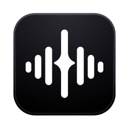

  

<h1 align="center">Vesper</h1>

<b>Your music. Your machine. Nothing else.</b>

A small, honest music player for Windows that plays the files already on your computer. 
No account, no subscription, no cloud, no network requests.

---

## What it is

Vesper is a local music player. It reads the audio files you already own and keeps them where they are. Nothing is uploaded, nothing is synced, nothing is indexed by anyone but you.

The whole player is a native Rust core wrapped in a compact interface, which is why it opens instantly and stays out of the way while it plays. The fonts, the icons and the engine all ship inside the app, so the internet cable can stay unplugged.

---

## The floating widget

<i>A second, much smaller player that lives on the desktop.</i>

<table>
<tr>
<td width="50%" align="center">
 
<b>Pill</b> 
Artwork, transport controls, a progress bar and the timecodes.
</td>
<td width="50%" align="center">
 
<b>Cover</b> 
Album art, song title and artist, and nothing else.
</td>
</tr>
</table>

The widget sits on the wallpaper like a small remote control that is always within reach, and it can stay above other windows or sit behind them. It shares one playback engine with the main window, so the two never fall out of step.

Two shapes, compact and expanded. Opacity is adjustable down to a ghost, and clicks can pass straight through to the desktop underneath.

---

## Features

**Library**
Import folders or single files. Folder imports keep picking up new songs you drop in later. Drag and drop works anywhere in the window, and File Explorer can hand files straight to Vesper. Search finds anything in the library as you type.

**Playback**
A native audio engine with gapless queue handling, shuffle, repeat-all and repeat-one. Playback speed runs from 0.5× to 2.0× without the pitch drifting. Hardware media keys, Bluetooth headphone buttons and the Windows volume flyout all stay in sync with the app.

**Covers**
Every song can carry its own artwork, and playlists can have a cover of their own. Covers survive restarts, get replaced cleanly when you pick a new one, and fall back to a generated tile when there is nothing to show.

**Equalizer**
Ten bands with a preamp and a set of ready-made presets, from Bass Boost to Late Night Soft. Settings persist per install.

**Lyrics**
Synced lyrics scroll line by line with the song. Any line can be clicked to jump to that moment.

**Desktop widget**
The floating player above, sharing the same engine, with optional artwork, progress bar, volume and adjustable opacity.

**Formats**
MP3, FLAC, WAV, M4A, AAC, OGG, Opus and AIFF.

---

## Under the hood

| Layer | Detail |
| --- | --- |
| Core | Rust, playing through rodio |
| Shell | Tauri 2, no Electron runtime |
| Interface | React 19 and TypeScript, bundled with Vite |
| Storage | SQLite for the library, playlists, settings and covers |
| Installer | Around 4 MB, WebView2 downloaded at install time |

There is no telemetry, no analytics and no update ping. The app makes no outbound requests of any kind.

---

## Private by design

Vesper only reads. It never modifies, moves or deletes your audio files, and it only reads the image you deliberately choose as a cover. Anything it needs is copied into its own folder, separate from your music.

Uninstalling removes everything Vesper created, so a fresh install starts clean. Your music stays exactly where you left it.

---

## Platform

Windows 10 version 1803 or newer, and Windows 11. 64-bit only.

Windows 7 and 8 are not supported. They are missing the browser engine the interface runs on, and no launcher or patch can add it.

---

## Credits

| Typeface | Role | Author | Licence |
| --- | --- | --- | --- |
| Delight | Headings and the wordmark | [Rajesh Rajput](https://www.behance.net/rajputrajesh) | Freeware |
| Open Sauce One | Interface and body text | [Alfredo Marco Pradil](https://github.com/marcologous/Open-Sauce-Fonts) | SIL OFL 1.1 |

Both faces ship inside the app in `public/fonts`. The typeface credits also appear in Settings, under About.

---

## Made by

**Shohail Mahmud**

Instagram: [@shohailmahmud09](https://instagram.com/shohailmahmud09)

Email: nirjonpc@gmail.com

Bugs and feature requests are easiest to send there.

---

## License

MIT. See [LICENSE](LICENSE) for the full text.
