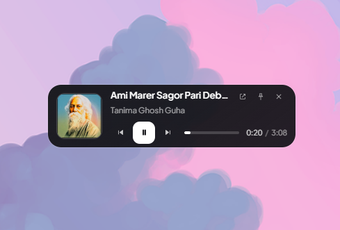

# Vesper

**Your music. Your machine. Nothing else.**

Vesper is a music player for Windows that plays the songs already on your computer — no account to create, no subscription, no internet connection required. Import your folders once and everything is there every time you open it.

---

## The little player that floats on your desktop

Keep the music in sight without keeping the whole app open. Vesper's widget sits on your desktop like a small, always-there remote — over your wallpaper, above other windows if you want, synced with whatever is playing.

<table>
<tr>
<td width="50%" align="center">
 
<b>Pill</b> — artwork, controls, progress bar and time
</td>
<td width="50%" align="center">
 
<b>Cover</b> — just the album art and the song name
</td>
</tr>
</table>

Pick whichever you like in **Settings → Widget**. Switching is instant — the widget reshapes itself, no restart.

- Click the artwork to **play or pause**. Double-click it to open your full library.
- Keep it **on top of other windows**, or let it sit behind them.
- Make it **see-through**, or let clicks pass straight through to your desktop.
- Choose **compact** or **expanded** to match how much space you want to give it.

---

## What you can do

### Build your library
- **Import a folder** and Vesper remembers it as a playlist you can come back to — including new songs you add to it later.
- **Import single songs** if you don't want a whole folder added.
- **Drag and drop** files or entire folders onto the window. Or just double-click any song in File Explorer and choose *Open with Vesper*.
- **Find anything instantly** with `Ctrl + F` — no scrolling through hundreds of songs.

### Make it yours
- **Give any song its own cover art.** Pick an image once and it stays, even after you restart.
- **Rename and organise** your folder playlists however makes sense to you.
- **Remove** anything from your library without ever touching the actual files on your disk.

### Listen the way you want
- **10-band equalizer** with ten ready-made presets — Bass Boost, Vocal Clarity, Late Night Soft and more — plus a preamp so you can push it exactly as far as you like.
- **Change the speed** from 0.5× to 2.0× without the pitch going weird.
- **Synced lyrics** shown line by line, following the song. Click any line to jump straight to that moment.
- **Queue, shuffle and repeat** — including repeat-one, and it all survives a restart.
- **Hardware media keys** on your keyboard work, along with your Bluetooth headphones' play/pause button, and the Windows volume flyout shows the song and cover art.
- Music keeps playing **smoothly while you browse, scroll or game** — no cracking, no stuttering.

### Supported formats
MP3, FLAC, WAV, M4A, AAC, OGG, Opus and AIFF.

---

## Install

1. Go to [**Releases**](../../releases/latest) and download `Vesper_<version>_x64-setup.exe`.
2. Run it. That's it — there's no account screen and nothing to configure.

> **Please use the `-setup.exe`.** The `.msi` installs the same app but leaves your library behind when you uninstall.

### What your PC needs

| Requirement | Detail |
| --- | --- |
| **Windows** | 10 (version 1803 or newer) or Windows 11 |
| **Type** | 64-bit |

Windows 7 and 8 aren't supported — they're missing the browser engine Vesper runs on. Nothing can be done about that from a launcher or patch.

---

## Your files stay yours

Vesper only ever **reads** your music, and only ever reads the picture you choose as a cover. It copies what it needs into its own folder and never modifies, moves or deletes your originals.

Uninstalling Vesper removes everything it created — your library, playlists, settings and saved covers — so the next install starts completely clean. Your music files are exactly where you left them.

---

## Keyboard shortcuts

| Shortcut | What it does |
| --- | --- |
| `Space` | Play / pause |
| `←` `→` | Skip back / forward 5 seconds |
| `Shift + ←` `Shift + →` | Previous / next song |
| `Ctrl + F` | Search your library |
| `S` | Shuffle on / off |
| `R` | Repeat: off → all → one song |
| `M` | Mute |
| `Q` | Show the up-next queue |
| `L` | Show lyrics |
| `E` | Show the equalizer |
| `W` | Show or hide the desktop widget |

---

## Made by

**Shohail Mahmud**

- Instagram: [@shohailmahmud09](https://instagram.com/shohailmahmud09)
- Email: <!-- TODO: put your Gmail address here, e.g. yourname@gmail.com -->

Found a bug, or want a feature? Message me on Instagram — that's the fastest way to reach me.

---

## License

See [LICENSE](LICENSE).
